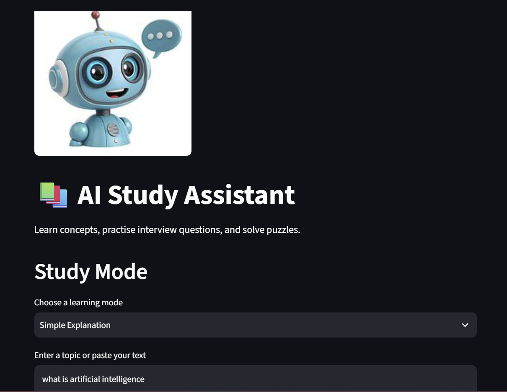
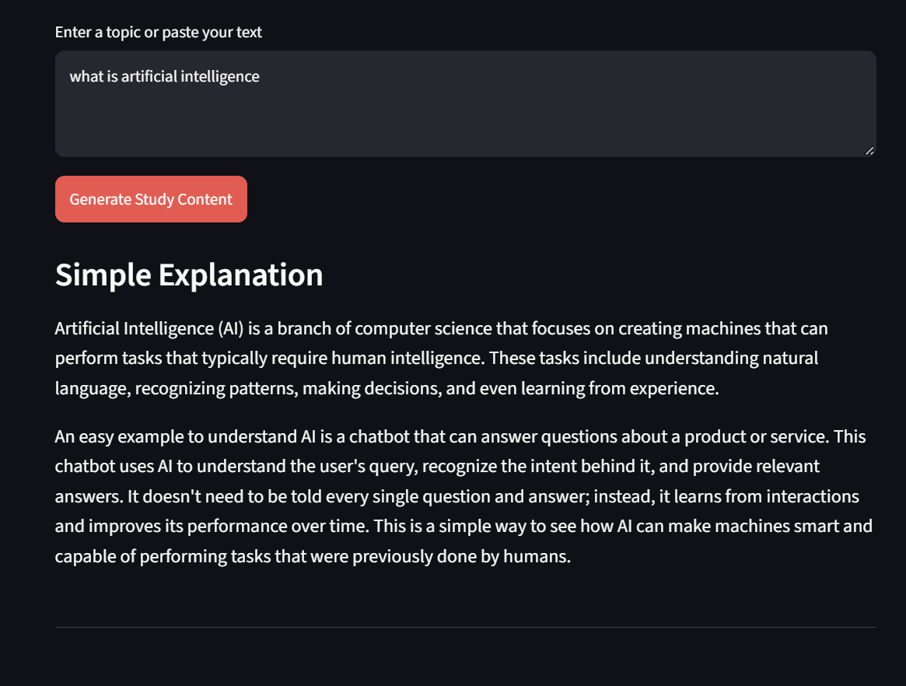
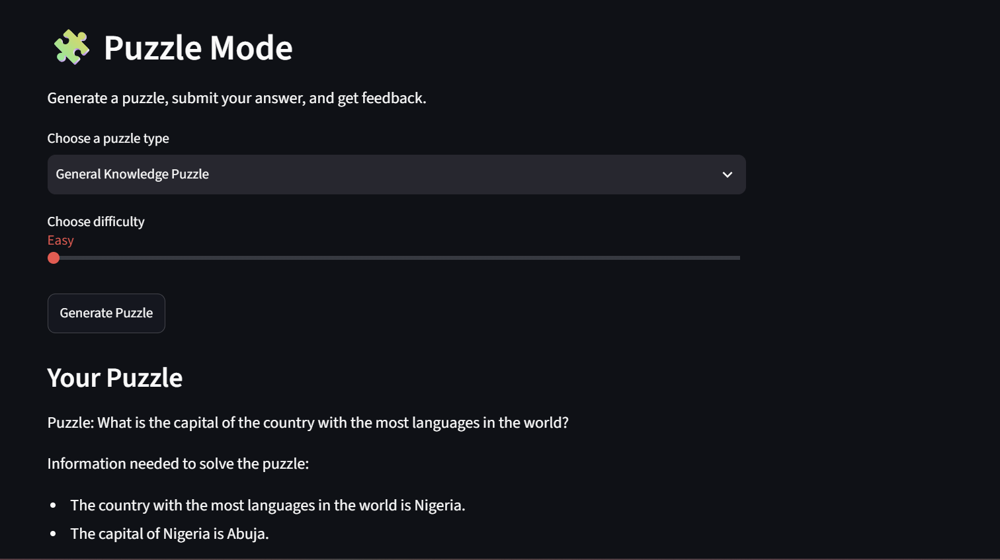
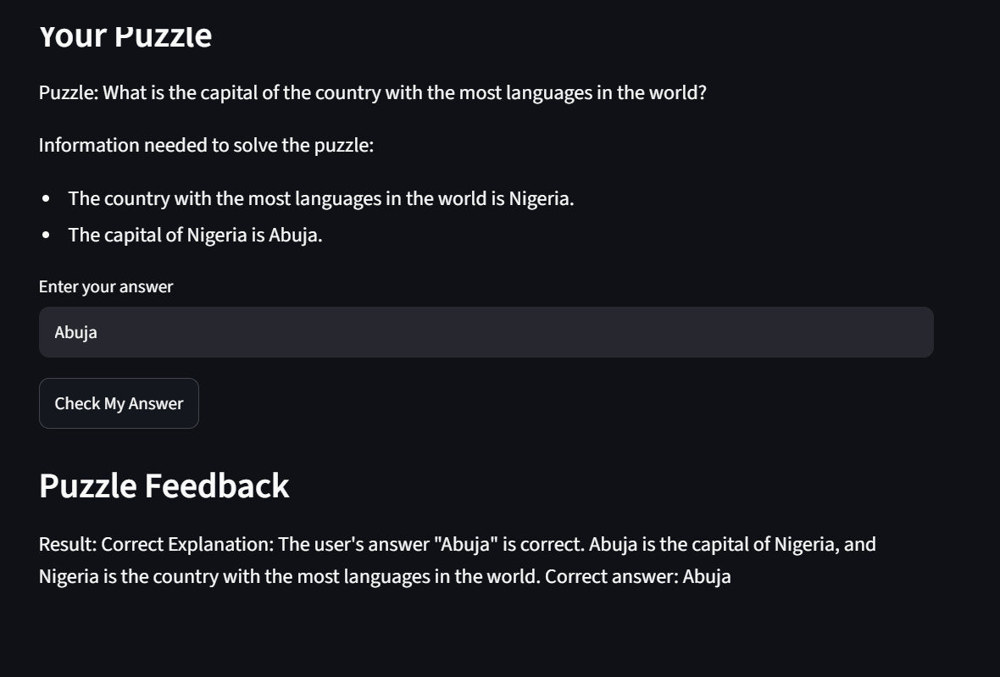

# AI Study Assistant

An AI-powered learning application developed using Python, Streamlit, LangChain, and Ollama. It helps students understand topics, summarize text, prepare for interviews, practise puzzles, and receive feedback on their answers.

## Application Screenshots

### Study Mode




### Puzzle Mode




## Features

### 📚 Study Mode

Choose from five learning modes:

- **Simple Explanation:** Understand concepts using simple English and easy examples.
- **Summary:** Extract the main points from a topic or text.
- **Step-by-Step Explanation:** Learn concepts in a logical order.
- **Practical Examples:** Explore concepts through real-world examples.
- **Interview Questions:** Generate five interview questions with answers.

### 🧩 Puzzle Mode

- Generate logic puzzles, riddles, math puzzles, and general knowledge puzzles.
- Choose Easy, Medium, or Hard difficulty.
- Submit an answer for evaluation.
- Receive feedback, reasoning, and the correct answer.

## Technologies Used

- Python
- Streamlit
- LangChain Core
- LangChain Ollama
- Ollama
- Qwen 2.5 1.5B
- Large Language Models (LLMs)

## How It Works

1. Select a study mode or puzzle type.
2. Enter a topic or choose puzzle settings.
3. LangChain formats the instructions and sends them to the local Ollama model.
4. The model generates study material or a puzzle.
5. In Puzzle Mode, submit an answer to receive AI-generated feedback.

## Project Structure

```text
AI_Study_Assistant/
├── app.py
├── README.md
├── pyproject.toml
├── uv.lock
├── .gitignore
├── assets/
│   └── chatbot.jpg
└── screenshots/
    ├── study_mode.png
    └── puzzle_mode.png
```


## Requirements

- Python 3.11
- Git
- uv package manager
- Ollama
- Qwen 2.5 1.5B model

## Installation and Usage

### 1. Clone the repository

```bash
git clone https://github.com/sayanajoseph/AI_Study_Assistant.git
cd AI_Study_Assistant
```

### 2. Install Ollama

Download and install Ollama from https://ollama.com/.

### 3. Download the language model

```bash
ollama pull qwen2.5:1.5b
```

### 4. Install Python dependencies

```bash
uv sync
```

### 5. Run the application

```bash
uv run streamlit run app.py
```

Streamlit will display a local URL to open the application in your browser.

## Limitations

- AI-generated explanations and puzzle evaluations may contain errors.
- Puzzle answers should be checked carefully, especially for ambiguous puzzles.
- A downloaded local model and sufficient computer resources are required.
- The application requires Ollama to be running.

## Future Improvements

- Add PDF upload and document-based question answering.
- Save study history and previous puzzle attempts.
- Add quizzes and progress tracking.
- Improve puzzle answer validation.
- Add more learning modes and subjects.

## Author

**Sayana Joseph**

AI Engineer Aspirant | BCA Graduate
